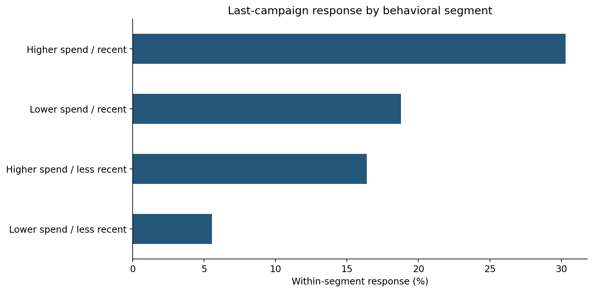

# Customer Segmentation & Campaign Response

[](https://github.com/sharankumarsrathod12345/food-marketing-analysis-python/actions/workflows/validate-notebooks.yml)

**Python · pandas · Data quality · Exploratory analysis · Business communication**

A Python case study in turning customer data into a testable marketing recommendation. **Course-based portfolio work by Sharan Kumar Rathod; not a paid client engagement.**

[Business summary](docs/business-summary.md) · [Executed notebook](notebooks/food_marketing_analysis.ipynb) · [Aggregate tables](outputs/) · [Methodology](docs/review-notes.md)

## The question

Which customer groups show different spending and response patterns, and what should be tested before changing marketing allocation?

## Findings and implications

| Finding | Evidence | Decision implication |
|---|---|---|
| Latest campaign response was 15.39% | 311 / 2,021 deduplicated profile rows | Establish a descriptive baseline before evaluating a new campaign. |
| Higher-spend, recent profiles responded at 30.30% | 100 / 330 profiles | A candidate segment for a controlled test; this is not measured incremental lift. |
| Lower-spend, less-recent profiles responded at 5.56% | 38 / 683 profiles | Investigate offer relevance and contact economics before allocating budget. |
| Store purchases outnumbered web and catalogue purchases | 11,737 / 8,317 / 5,345 recorded purchases | Compare activity, but obtain revenue and cost data before recommending channel spend. |



## What this demonstrates for a client

A handoff containing documented data checks, clear metric definitions, reproducible Python code, charts, aggregate CSV tables, and recommendations bounded by the evidence. These are examples of deliverables for a scoped customer-data and campaign-analysis assignment.

## Analytical approach

1. Reconcile 2,205 raw rows to 2,021 rows after removing 184 exact duplicates; compare shared columns with the supplied cleaned reference.
2. Validate campaign flags, categorical indicators, missingness, and the definition of food spending.
3. Separate last-campaign response from any recorded campaign acceptance; report within-segment rates and denominators.
4. Segment profiles by sample-median spending and 30-day recency; export charts and reusable aggregate tables.

## Run locally

Clone or download this repository. The supplied input CSVs are in `data/`.
Use Python 3.12 (the recorded validation environment):

```bash
python -m venv .venv
# macOS/Linux:
source .venv/bin/activate
# Windows PowerShell alternative: .venv\Scripts\Activate.ps1
python -m pip install -r requirements.txt
python analysis.py
```

Run commands from the repository root. The script also supports an absolute file path from another directory. It writes aggregate tables and charts to `outputs/`. For a headless environment, set `MPLBACKEND=Agg`.

To explore interactively, run `jupyter lab` and open `notebooks/food_marketing_analysis.ipynb`. To check a native kernel:

```bash
jupyter nbconvert --execute --to notebook --output verified.ipynb notebooks/food_marketing_analysis.ipynb
```

The saved notebook contains results. Download `notebook-preview.html` and open it locally for an HTML view; GitHub displays HTML source rather than hosting that page.

## Repository guide

| Location | Purpose |
|---|---|
| `analysis.py` | Standalone analysis and output generation |
| `notebooks/` | Narrative analysis with saved tables and figures |
| `data/` | Inputs and source notes |
| `outputs/` | Aggregate results and charts |
| `docs/business-summary.md` | Findings, recommended next step, and handoff scope |
| `docs/reproducibility.json` | Input hashes and recorded package versions |

## Limits of the evidence

The case brief describes simulated data. There is no customer ID: identical-row removal is an assumption, not proof of duplicate people. The raw response rate is 15.10%, versus 15.39% after deduplication. Spending covers the last two years in the supplied dictionary, but exact dates, currency, and timing relative to campaigns are unknown. `MntTotal` excludes gold products. Associations are descriptive; no campaign ROI, causal lift, or client revenue improvement is claimed.

## Attribution and validation

The author identifies this as Alex the Analyst coursework. Original lesson and dataset URLs remain to be confirmed; dataset authorship is not claimed. See [data provenance](data/README.md). The repository's code license does not establish redistribution rights for third-party datasets or case materials.

**Native notebook validation passed on 25 October 2026.** All 9 code cells executed from a fresh Jupyter kernel on Python 3.12.15, and all 9 regenerated aggregate CSVs matched the published results within numerical tolerance. Input SHA-256 checks and notebook-format validation also passed.

[View the successful validation run](https://github.com/sharankumarsrathod12345/food-marketing-analysis-python/actions/runs/40205390284) · [Validation evidence](docs/native-validation.json)

GitHub Actions reruns this check when notebooks, data, baseline outputs, or validation code change. The run's `notebook-validation` artifact contains freshly executed notebooks, HTML previews, charts, and a validation report (retained for 14 days). Run locally with `python scripts/validate_notebooks.py` after installing the project requirements and `nbclient nbformat ipykernel`.

This verifies execution and numerical reproducibility; it does not establish dataset provenance, causal effects, or business impact.
