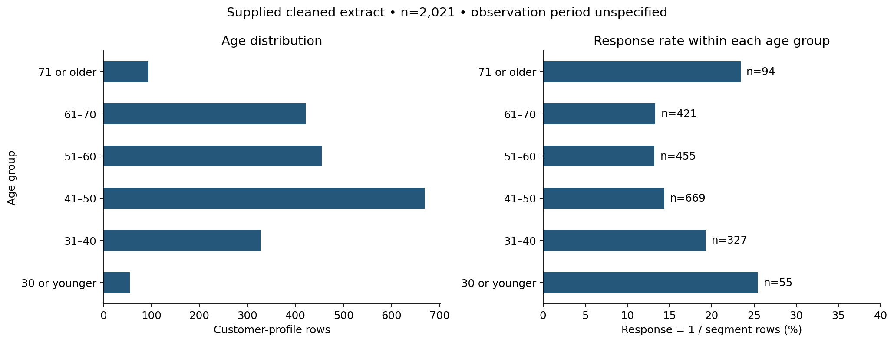
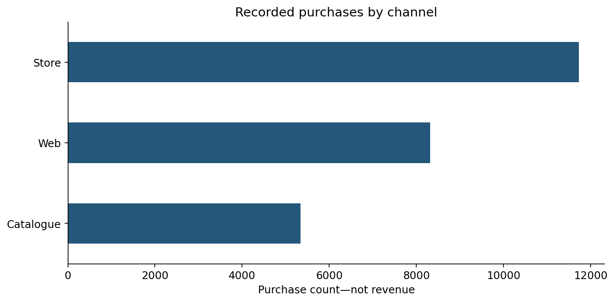

# Food Marketing Analysis with Python
**Customer segments · Campaign response · Reproducible pandas analysis**

[Open the notebook](notebooks/food_marketing_analysis.ipynb) · [Review methodology](docs/review-notes.md)

## Business question
Which customer segments show different response and spending patterns, and what evidence is needed before changing marketing allocation?

## Verified findings
- 2,021 profile rows; no exact duplicate rows or missing cells in the supplied cleaned file.
- 311 positive `Response` indicators: **15.39%** of profile rows.
- Any recorded campaign acceptance, including `Response`: **563 profiles (27.86%)**.
- No children at home: **27.87% response**, n=567; one child: **10.42%**, n=1,027.
- Recorded purchases: **11,737 store**, **8,317 web**, **5,345 catalogue**. These are counts, not channel revenue.




## Run
Use Python 3.10+ from the repository root:
```bash
python -m pip install -r requirements.txt
python analysis.py
```
Or open the notebook in Jupyter and restart/run all cells. Put `u_food_marketing.csv` and `cleaned_ufood_marketing.csv` in `data/` first. The handoff includes both source and cleaned files; `.gitignore` excludes row-level CSV inputs from Git by default pending source/reuse confirmation.

## Definitions and limitations
`Response` is analyzed separately from any campaign acceptance. `MntTotal` reconciles to five food/drink spending fields and excludes gold products. There is no customer ID to verify unique people. The supplied dictionary defines spending over the last two years; exact calendar dates, currency, and reuse terms remain unconfirmed. Removing 184 exact duplicates from 2,205 source rows reproduces every shared field in the 2,021-row cleaned file. The undeduplicated response rate is 15.10%, versus 15.39% after deduplication. Results describe the provided extract; they are not causal estimates or a forecast of marketing ROI.

## Attribution
Course-practice project by **Sharan Kumar Rathod**, identified by the author as Alex the Analyst coursework. Exact lesson and original dataset links need confirmation. This revision improves metric definitions, checks, and interpretation; it does not claim original dataset authorship.

## Validation
All analysis cells executed in order on the supplied CSV using a Python cell runner; saved outputs and reconciliation checks passed. Native Jupyter execution was blocked by workspace socket restrictions; run Restart & Run All locally for a native-kernel check. See `docs/review-notes.md` for corrections and reproducibility details.

## Behavioral segmentation
Four segments combine sample-median food spending with a 30-day recency cutoff. This adds behavioral context without defining segments using the campaign outcome. See `outputs/behavior_segments.csv`; this is descriptive and does not establish causal lift.

## Case materials
The supplied case brief describes a simulated dataset. The dictionary confirms campaign indicators and purchase-count definitions. See the files in `docs/`. Original external source/lesson URLs are still needed for complete attribution.
